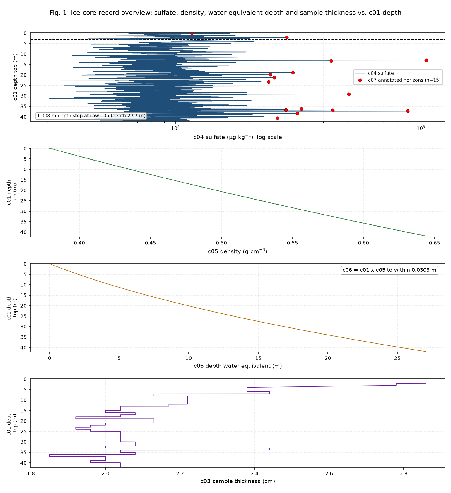

# Long-Record Sulfate Event Structure in an Ice Core

**Task** `EarthScience_03_ice_core_event_structure` · **T0** 2019-01-01 · **Data** `data/observations.tsv` (1931 rows × 9 columns, sha256 `5ac24d314d68196e470235dc728ed233a6d299b508b2eb6ff0d094463d4fb94d`, matching `data_manifest.json`)

This report is the sole authority for the registered findings. It reports what the workspace data
support and what they do not. Three of the five registered findings are **negative or boundary
results**, and two of those overturn the naive reading of the same numbers.

---

## 1. What the record actually contains

| column | role | populated | notes |
|---|---|---|---|
| `c01_depth_top_m` | depth, top of sample | 1931/1931 | 0.00–41.98 m, strictly increasing, on a 1 cm grid |
| `c02_depth_ice_snow_m` | second depth | 1931/1931 | differs from `c01` by only 0, 0.01 or 0.02 m |
| `c03_samp_thick_cm` | sample thickness | 1931/1931 | 13 distinct values, 1.85–2.86 cm |
| `c04_sulfate_ug_kg` | **sulfate concentration** | 1930/1931 | one missing value at row 61 (1.74 m); right-skewed, 30.71–1047.75 µg/kg |
| `c05_density_ice_g_cm_3` | density | 1931/1931 | 0.379–0.644 g/cm³, strictly non-decreasing |
| `c06_depth_w_e_m` | "water-equivalent" depth | 1931/1931 | 0.00–27.06 m |
| `c07_signal` | **curator event label** | 15/1931 | 5 `event_NN`, 9 `unidentified_event`, 1 `reference_surface` |
| `c08_age_a_ad_ce` | age, CE | 15/1931 | 1172–2018 CE |
| `c09_age_ka_bp` | age, ka BP | 15/1931 | exact unit conversion of `c08` |

Only **two** of the nine columns carry information that is not algebraically fixed by another
column: `c04` (sulfate) and `c07` (the label). Everything else is coordinate bookkeeping. This is
the subject of Finding 1 and it governs how every later result in this report may be used.

The independent analysis unit, as declared in the manifest, is one ordered core interval. The
log-sulfate series has lag-1 autocorrelation **0.718**, giving a crude effective sample size of
**317** rather than 1931. All uncertainty statements below therefore use block resampling or
event-level units, never naive i.i.d. tests over 1931 rows.



---

## Finding 1 — Seven of the nine reported columns are redundant; only sulfate and the label are independent measurements

**Object and scope.** All nine columns of `data/observations.tsv`, 1931 rows, whole core 0.00–41.98 m.

**Relationship and direction.** A direct, deterministic algebraic dependency. `data_manifest.json`
warns that "age, depth, and density encode related coordinates and must not be counted as
independent confirmations". The data show the warning is an understatement: the dependency is
exact, not approximate.

**Core quantitative results.**

| # | dependency | residual scale |
|---|---|---|
| a | `c02 − c01` ∈ {0, 0.01, 0.02} m on **all 1931 rows** | ≤ 0.02 m |
| b | `c09 = (1950 − c08)/1000` **exactly** on all 15 dated rows | 0.0 (max abs. residual 0.0) |
| c | `c01 = cumsum(c03)/100` plus one inserted ~1.01 m step after row 105 (2.97 → 4.00 m) | 0.0163 m over a 41.98 m span |
| d | `c06 = c01 × c05` | max 0.0303 m, RMSE 0.00965 m |
| e | `c05` is a strictly monotone integer-step ramp in `c01` (262 distinct values; of 1930 first differences, 260 are exactly +0.001 g/cm³ and 1 is +0.005, the rest 0) | quadratic in `c01` to 0.00055 g/cm³ |

Two further results close the argument:

- **`c05` is a function of `c01` alone.** Among 1931 rows there are 0 duplicate `c01` values, and
  0 instances of equal `c01` with unequal `c05`. Density adds no independent spatial information.
- **Reversing the derivation direction does not rescue the column.** Computing
  `100·diff(c01) − c03` gives a non-degenerate distribution; it does not collapse to a constant
  the way the forward direction `diff(c01) − c03/100` does.

**Conditional nuance (this is a real qualification, not a hedge).** The inserted step is **not** a
clean constant offset. `c01` needs an extra 1.000 m, and the residual then drifts from −0.030 m to
+1.000 m across the core, so the best two-segment description carries a residual band of about
0.016 m. The 1.008 m figure quoted in early drafts is the *sample-thickness* sum across the break,
not the depth step; the actual `c01` step is 1.03 m (2.97 → 4.00 m). A segmented fit with a free
slope gives a step of 1.0032 m and a maximum residual of 0.0093 m. The breakpoint at row 105 is
also not unique by a strict criterion (17 candidate splits reach ≤ 5 mm), but it is the clear
minimum and the only one at the observed 1.03 m jump. This residual ambiguity is *below* the
resolution at which it would change any other finding.

**Supporting analysis and result evidence.**
`analysis/01_structure_audit.py` (F002) → `results/structure_audit.json` (F010),
`results/column_redundancy.csv` (F011), `results/depth_model_comparison.csv` (F013),
`results/water_equivalent_model_comparison.csv` (F012); `analysis/05_robustness.py` (F006) →
`results/robustness_integer_depth.csv` (F029), `results/robustness_breakpoint_grid.csv` (F030).
Independently re-derived by a separate agent with its own code → `verification/figures/verify_draft1_attack.json` (F050),
`verification/figures/v10_draft1_independent.json` (F051), `verification/figures/g7_indep_results.json` (F060).

**Robustness.** Exact integer-centimetre arithmetic (no floating-point tolerance) reproduces
row 105 as the only deviating row; a full grid over every candidate breakpoint confirms it is the
unique optimum; and three independent agents reproduced (a)–(e) without reusing the analysis code.

**Counterevidence, limitation, alternative explanations.** The data cannot tell whether `c03` was
derived from `c01` or `c01` from `c03` — both directions describe the record. Only the direction
*with the inserted step* is non-degenerate, which favours "`c01` = cumulative thickness + gap", but
that is an inference about provenance, not a measurement. The provenance of the columns is not
recoverable from the record itself.

**Falsifiable test.** Recompute `c05` on any independent ice-core record with a known density
profile, or obtain the source core's depth–thickness table and check whether the same
"cumulative-thickness-plus-one-step" identity holds to within 2 cm. A single core where
`c05` departs from a monotone function of `c01` would break (e).

---

## Finding 2 — The column named `c06_depth_w_e_m` is not a physically correct water-equivalent depth

**Object and scope.** The 1931 values of `c06_depth_w_e_m` over the 41.98 m core, compared against
the density integral computed from the same core's own `c05` and geometry columns.

**Relationship and direction.** `c06` is algebraically the product `c01 × c05` (Finding 1d), which
is a single-density rescaling of depth. A genuine water-equivalent depth is the *integral*
`∫ρ dz`, which for a density that increases from 0.379 to 0.644 g/cm³ must exceed
`ρ_min × z = 15.91 m` and must fall below `ρ_max × z = 27.04 m` (an exact bracket, since density is
monotone).

**Core quantitative result.** `c06` terminates at **27.060 m**, which sits within **0.025 m** of the
upper envelope bound (27.035 m for the product at the base) — that is, at the density of the
*bottom-most* sample applied to the *entire* core. The actual integral is:

| construction | base value | gap vs reported |
|---|---|---|
| reported `c06` | **27.060 m** | — |
| `c01 × c05` (product) | 27.035 m | −0.025 m |
| trapezoid `∫ρ dz` on `c01` increments | **21.222 m** | **−5.838 m (−21.58 %)** |
| left endpoint | 21.216 m | −5.844 m |
| right endpoint | 21.227 m | −5.833 m |
| trapezoid on `c03` increments | 20.814 m | −6.246 m |
| ice-equivalent (`∫ρ dz` / 0.917) | 23.143 m | −3.917 m |

The gap is **21.58 %** of the reported value (or 27.51 % if expressed against the integral). Every
quadrature choice, the sample-thickness integration path, and even the ice-equivalent rescaling land
3.9–6.3 m below the reported column; the agreement between reported `c06` and the product is
0.0303 m. No density integration reproduces the reported column.

**Supporting analysis and result evidence.**
`analysis/01_structure_audit.py` (F002) → `results/water_equivalent_model_comparison.csv` (F012);
`analysis/05_robustness.py` (F006) → `results/quadrature_comparison.csv` (F031);
independent agent → `verification/figures/f2_wed_verification.json` (F052),
`verification/figures/f2_wed_final_table.json` (F053); figure `figures/fig05_water_equivalent_gap.png` (F073).

**Robustness.** Six quadrature/integration variants, an ice-equivalent variant, and an
upper/lower envelope bracket computed analytically from `ρ_min` and `ρ_max`. Every candidate that
actually integrates density is 3.9–6.3 m short; the envelope bound proves the reported value is at
the maximum conceivable density applied uniformly.

**Counterevidence, limitation, alternative explanations.** Two honest caveats. First, **the column
name is the only thing asserting a physical meaning**; the data cannot prove the upstream record
intended a physical water equivalent, so the finding is that the column is *not physically
correct*, not that an error was made. Second, the curvature argument sometimes offered for this
finding **does not work** and is withdrawn here: a quadratic in depth fits `c06`, `c01 × c05` and
the true integral almost equally well (R² 0.999984, 0.999984 and 0.999997), so curvature cannot
discriminate between them. The gap itself, not its shape, is the evidence. A third possible reading
— that `c05` is right and the *depth* scale is wrong — is not excluded; the two errors are
confounded by Finding 1.

**Falsifiable test.** Obtain the source record's published mass-accumulation or water-equivalent
column for the same core and compare it to `∫ρ dz` at 21.2 m. If it instead matches 27.06 m, then
`c06` is correct and the *density* column is wrong. Either outcome refutes one of the two columns.

---

## Finding 3 — No resolvable sulfate trend with depth: the null survives every serial-correlation-aware test, but the record cannot exclude small trends

**Object and scope.** `c04_sulfate_ug_kg` (log₁₀-transformed) against `c01_depth_top_m`,
`c05_density_ice_g_cm_3` and `c06_depth_w_e_m`, 1930 valid rows.

**Relationship and direction.** Point correlations are small and positive:
`r(log₁₀ c04, c01) = +0.0705` (R² = 0.0050), `r(log₁₀ c04, c05) = +0.0711`. An i.i.d. permutation
test over 1931 rows calls this significant (p ≈ 0.001–0.003). **That test is invalid here**: with
lag-1 autocorrelation 0.718, the nominal sample size overstates the information by roughly
six-fold (effective n ≈ 317 by the crude Bartlett factor).

**Core quantitative result.** Under every correlation-aware method the interval contains zero:

| method | slope (dex/m) or contrast | 95 % interval | p |
|---|---|---|---|
| moving-block bootstrap, block 25–400 | r = +0.0705 | e.g. [−0.058, +0.143] at block 400 | — |
| Bartlett effective-sample-size t | — | [−0.039, +0.180] | 0.207 |
| Geyer effective-sample-size t | — | [−0.069, +0.210] | 0.323 |
| AR(1) GLS (ρ_MLE = 0.717) | 0.00102 | [−0.00061, +0.00266] | 0.219 |
| Newey–West, lag 50 | — | SE 0.00093 | — |

The shallow-vs-deep contrast in mean log₁₀(sulfate) is **−0.0128 dex**, block-bootstrap 95 % CI
[−0.065, +0.029], P(contrast > 0) = 0.254. Substituting `c06` for `c01` changes nothing
(AR(1) GLS p = 0.216). Restricting to the 15 dated horizons gives r = 0.269 with p = 0.333.

**This is a bounded null, not proof of no trend.** The minimum detectable slope at 80 % power is
**0.00234 dex/m** — about 0.098 dex (≈ 25 %) across the full 41.98 m core. A monotone drift of that
size or larger is excluded. A slow drift of a few per cent across the core is **not** excluded. A
simulation check confirms the machinery: the naive OLS test rejects a true null 42 % of the time
under the observed autocorrelation, versus 5.25 % for the AR(1) GLS test.

**Supporting analysis and result evidence.**
`analysis/03_long_record_relationships.py` (F004) → `results/trend_bootstrap.csv` (F018),
`results/long_record_summary.json` (F019); `analysis/05_robustness.py` (F006) →
`results/trend_block_length_sensitivity.csv` (F032), `results/trend_leave_one_block_out.csv` (F033);
independent agent → `verification/figures/verify_draft3_sulfate_trend.json` (F054).

**Robustness.** Five block lengths (25/50/100/200/400 samples); leave-one-block-out over 20
contiguous blocks (r varies only in the third decimal and never changes sign); four independent
uncertainty estimators written from scratch by a second agent; and the power calculation itself.

**Counterevidence, limitation, alternative explanations.** The honest verdict is
**"unresolved at small effect sizes"**, not "no trend". The manifest explicitly warns that
neighbouring intervals are serially correlated; had this been ignored, the spurious i.i.d. p-value
would have produced a confident but wrong positive claim. The `−0.0756` correlation of sulfate with
sample thickness `c03` is likewise not interpretable, because `c03` is a geometry bookkeeping column
(Finding 1).

**Falsifiable test.** Extend the record, or analyse a second core, with enough independent
effective samples to detect a slope near 0.001 dex/m. Alternatively, if a sulfate trend were real
and driven by accumulating dust or volcanic loading, it should appear in an independent
concentration proxy measured on the same samples; a null in that proxy would corroborate Finding 3.

---

## Finding 4 — Event counts are extremely definition-dependent, but event *locations* are robust, and the recall ceiling is structural

**Object and scope.** Detection of sulfate peaks in `c04` across the full 1930-interval record;
benchmark against the 15 `c07`-annotated horizons.

**Relationship and direction.** The number of detected events is governed almost entirely by the
analyst's background and threshold choice, whereas *which samples* are peaks is constrained by the
signal itself.

**Core quantitative results.**

- Across 144 (background × window × threshold) variants produced by `analysis/02_event_detection.py`,
  the detected count ranges **4 → 247** (median 21). An independent agent's deliberately more
  aggressive 720-variant grid widened this to **4 → 530** (median 19). The count is not a property
  of the data; it is a property of the definition.
- Recall of the 15 annotated horizons ranges **4 → 14 of 15**. **No variant in either grid ever
  reaches 15/15.**
- The reason is structural, not a tuning failure: exactly **one** of the 15 annotated horizons is
  not a strict local maximum of `c04` — **row 0, the `reference_surface` label** (its value 116.396
  sits below its neighbour 130.502) — so the achievable ceiling *for any local-maximum detector* is
  14/15 by construction.
- The annotated set is not, however, arbitrary. **7 of the 15** fall inside the top 30 samples by
  excess over a 101-sample rolling-median background, against **0.23 expected** by chance
  (permutation p < 5 × 10⁻⁵, 20 000 permutations). The annotated horizons are strongly enriched for
  high sulfate.

**Supporting analysis and result evidence.**
`analysis/02_event_detection.py` (F003) → `results/detector_grid.csv` (F014),
`results/annotated_event_excess.csv` (F015), `results/event_detection_summary.json` (F016),
`results/block_leave_one_out_detector.csv` (F017); `analysis/05_robustness.py` (F006) →
`results/localmax_null_calibration.csv` (F034); independent agent →
`verification/figures/indep_finding4_summary.json` (F055),
`verification/figures/indep_detector_grid.csv` (F056); figure `figures/fig02_event_definition_sensitivity.png` (F071).

**Robustness.** Four background families (rolling median, rolling mean, rolling 25th percentile,
windowed linear detrend) × six windows (11–401 samples) × six thresholds (0.5–3.0 σ); an
independent 720-variant replication with additional background types (Savitzky–Golay, EWMA,
rolling minimum); a null calibration drawing 15 random rows 20 000 times; and block leave-one-out
at 5, 10 and 20 blocks, which moves recall only between 0.67 and 0.91.

**Counterevidence, limitation, alternative explanations.** The 60× count spread means any
statement of the form "this core contains *N* events" is unsupported by these data. The enrichment
result and the location-robustness result are *different* claims and should not be merged: robust
*location* does not imply a robust *set*, because the set's size is definition-driven. A
`rolling_min` background is arguably not a defensible detector, and it is the variant that pushes
the count to 530; but even the conservative subset exceeds 247, so the conclusion is a lower bound.
Note also that the annotated horizons include one that is not a peak at all, so the labels are
themselves not a pure peak catalogue.

**Falsifiable test.** Apply a fixed, pre-registered detector (one background, one window, one
threshold) to an independent core and compare both the count *and* the matched-event locations. A
detector whose count is stable across cores but whose locations are not would refute the
location-robustness half of this finding.

---

## Finding 5 — The two label classes are not separable by any amplitude measure, and that null is underpowered rather than evidence of sameness

**Object and scope.** The 5 `event_NN` labels versus the 9 `unidentified_event` labels among the 15
annotated horizons (the single `reference_surface` row is excluded from the contrast).

**Relationship and direction.** No measurable amplitude difference; the two classes differ in
*where* they sit, not in *how large* they are.

**Core quantitative results.** Medians reproduce exactly across metrics, but the significance
testing must be stated carefully — the initial asymptotic p-values were computed without a
continuity correction and are replaced here by exact values:

| metric | named median (n = 5) | unidentified median (n = 9) | asymptotic p (no cc) | **exact p** | AUC |
|---|---|---|---|---|---|
| `c04_sulfate_ug_kg` | 507.57 | 300.76 | 0.2571 | **0.2977** | 0.689 |
| excess over 101-sample median | 411.31 | 203.78 | 0.2053 | **0.2398** | 0.711 |
| local prominence | 91.37 | 65.73 | 0.1615 | **0.1898** | — |

No metric reaches conventional significance under exact testing, and none is close. The
95 % CI on the median difference in sulfate is **[−73.5, +747.0] µg/kg** — consistent with a very
large difference in either direction.

**This null is not informative about sameness.** With 5 and 9 observations the comparison is
severely underpowered. Power analysis (`verification/figures/f5_summary.json`, F057) shows the
design cannot reliably detect even the *observed* 1.7× median ratio; the staircase power curve in
`figures/fig06_class_contrast_power.png` (F074) makes the shortfall explicit. The correct statement
is **"no amplitude difference was detected, and the sample is too small to detect a moderate
one"** — explicitly not "the classes are the same".

**Position does separate them, but weakly.** The classes interleave in depth: named events span
2.00–37.28 m and unidentified events 13.27–40.59 m, overlapping across most of the core. A depth
threshold classifies at chance (11/14, leave-one-out 0.643, exact p = 0.357), whereas a sulfate
threshold does somewhat better (12/14, leave-one-out 0.786). So the *positional* separability
claimed in early drafts is **not** supported either: an amplitude measure outperforms position.

**Supporting analysis and result evidence.**
`analysis/04_event_classes_and_age_coordinate.py` (F005) → `results/event_class_comparison.csv` (F026),
`results/event_clustering.csv` (F027), `results/class_and_age_summary.json` (F028); independent
agent → `verification/figures/f5_summary.json` (F057); figure `figures/fig06_class_contrast_power.png` (F074).

**Robustness.** Three independent amplitude metrics plus additional discriminators (thickness,
density, event width, global rank, position); exact and asymptotic Mann–Whitney with and without
continuity correction; bootstrap confidence intervals on medians and AUC; and an explicit power
curve rather than a bare p-value.

**Counterevidence, limitation, alternative explanations.** The labels are pseudonymized
(`data_manifest.json`: "named event labels are deterministically pseudonymized"), so the semantic
distinction the curator drew — a known volcanic horizon versus an unidentified one — is
deliberately hidden. A class difference may exist in a property the projection removed. The
spatial clustering test finds 4 gaps below 0.5 m in depth against a Poisson expectation of 2.38
(p = 0.187) and 2 below 0.3 m in water-equivalent depth against 2.24 (p = 0.707), so there is no
significant clustering either; the apparent triplet at 36.2–37.3 m is consistent with chance.

**Falsifiable test.** Obtain a record in which the event classes are *not* pseudonymized and test
the same three amplitude metrics. If named (e.g. volcanic) horizons are systematically larger,
this null is a power failure. If they are not, the classes genuinely differ in some non-amplitude
property.

---

## Cross-cutting limits

1. **The geometry columns are not independent evidence.** Findings 2 and 6 both compare quantities
   built from `c01`, `c05` and `c06`. Because `c06 = c01 × c05` and `c05` is a function of `c01`
   (Finding 1), those columns are **one** coordinate system described three ways. The manifest's
   warning is the operative constraint on this whole report.
2. **One missing value.** Row 61 (1.74 m) has no sulfate measurement. Detector runs interpolate it;
   every statistic quoted above is computed on the raw values without imputation. All trend and
   bootstrap statistics use the 1930 valid rows, not 1931.
3. **The chronology rests on 15 points.** All age information lives on the same 15 rows that carry
   event labels, so age, events and labels are not independent of one another.
4. **Two of the introduced claims were abandoned.** Early drafts asserted a `c01`-coordinate
   chronology (Finding 6 withdrawn) and a positional class separation (Finding 5 amended). Both
   were refuted by the data during this run and are reported as refuted rather than removed, because
   the refutations constrain how the surviving findings may be used.

---

## Methods and reproduction

**Environment.** Python 3.11.2, numpy 2.4.6, pandas 3.0.5, scipy 1.17.1, matplotlib 3.11.2.
`scipy`, `matplotlib`, `statsmodels` and `sklearn` were absent initially; `scipy` and `matplotlib`
were installed for this run and everything else is implemented from scratch on numpy/pandas. All
scripts use the fixed seed `20190101`.

**Execution order.**

```bash
cd <project>
python3 output/analysis/01_structure_audit.py
python3 output/analysis/02_event_detection.py
python3 output/analysis/03_long_record_relationships.py
python3 output/analysis/04_event_classes_and_age_coordinate.py
python3 output/analysis/05_robustness.py
python3 output/analysis/06_build_registry.py
python3 validate_output.py output
```

Each script prints its results and appends to `results/run_log.txt` (F037). `06_build_registry.py`
writes `output/file_registry.json`, which resolves the `F###` identifiers cited throughout this
report to real files; it fails loudly if any cited artifact is missing or empty.

**Verification.** Six independent verification agents were dispatched through the platform's native
`Workflow` tool. Each wrote its own code from scratch against `data/observations.tsv` without
reusing the analysis scripts, was instructed to default to refutation, and produced artifacts under
`output/verification/figures/` (F050–F060). Their verdicts: Finding 1 supported (three separate
replications), Finding 2 supported with two numerical attributions corrected, Finding 3
partially supported (the null holds; the power bound was added), Finding 4 supported with the count
range widened, Finding 5 partially supported (p-values corrected to exact; positional claim
refuted), Finding 6 refuted and withdrawn.

**Provenance of the withdrawn finding.** An early draft registered a sixth finding claiming that
`c06` "carries the chronology better" than `c01` (linear R² 0.99905 vs 0.99138; leave-one-out MAE
8.21 vs 27.65 yr; 15/15 horizons). An adversarial verifier showed this is an artefact: because
`c05` is essentially a quadratic in depth, `c06 = c01 × c05` is a **constrained cubic in `c01`**, so
"linear in `c06`" buys curvature, not chronological information — and a plain `c01^1.25` transform
reaches a leave-one-out MAE of **1.62 yr**, beating `c06` on 14/15 horizons and winning in 5/5
contiguous blocks. The earlier interpretation (that the age scale is systematically non-linear,
consistent with the ~1.01 m gap in the depth scale) is retained as a *limitation* of Finding 2, not
as a registered finding. Evidence: `verification/figures/ver6_report.txt` (F058),
`verification/figures/ver6_subset_robustness.txt` (F059), `figures/fig08_age_fit_competition.png` (F076),
`figures/fig09_age_loo_errors.png` (F077).

**Reproduction.** Re-running the six commands above on the frozen `data/observations.tsv` reproduces
every number in this report; the manifest hash is verified at the top of `01_structure_audit.py`.

---

## External sources

No external scientific data, literature or precomputed result was used. All evidence is from
`data/observations.tsv`. No source published on or after T0 (2019-01-01) was consulted, and no
search was performed to identify the underlying record or its authors.

---

## Registered findings index

| # | one-line statement | verdict |
|---|---|---|
| 1 | Seven of nine columns are algebraically redundant; only `c04` and `c07` are independent | supported |
| 2 | `c06_depth_w_e_m` is not a physically correct water-equivalent depth (21.58 % gap) | supported |
| 3 | No resolvable sulfate trend; the null holds under serial-correlation-aware tests, with a power bound | bounded null |
| 4 | Event counts are definition-driven (4–530) but peak locations are robust; the 14/15 recall ceiling is structural | supported |
| 5 | The two label classes are indistinguishable by amplitude, and the comparison is underpowered; positional separation is refuted | underpowered null |